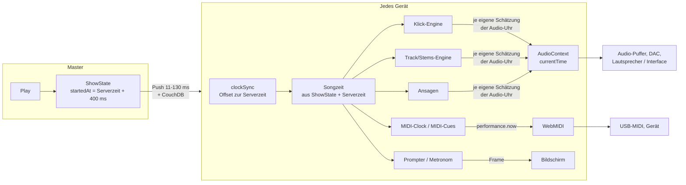

# 29 · Synchronität: eine Zeitbasis für alle Ausgänge und alle Geräte

Stand 2026-11-04. Konzept; die Zielzahlen (§1) sind beschlossen (Marco, 2026-11-04), der Rest ist noch kein Beschluss. Anlass: Messung mit dem Referenz-Song (#464) auf dem Fire - Klick und Track lagen nach jedem Play 0-55 ms auseinander (§3). Marco: „Die Synchronität aller Teile der App und über die Geräte hinweg ist der wichtigste Punkt der ganzen App. Alles soll an einer Zeitbasis hängen, nicht an verschiedenen."

Dieses Dokument beschreibt die ganze Signalkette, jede bekannte Abweichung mit gemessener oder abgeschätzter Größe, eine Worst-Case-Rechnung für heute und für das Ziel, das Konzept einer einzigen Zeitbasis, wie es auf der Bühne ohne ständige Kalibrierung zuverlässig bleibt, und wie wir es prüfen - nicht per Auge oder Gehör, sondern gemessen.

Verwandt: docs/09 (Uhr-Synchronisation zwischen Geräten), docs/13 §7 (Ausgabelatenz je Gerät), docs/19 (Track-Wiedergabe, Vorlauf), docs/21 (Timing-Klassen, Latenzmodell, Kalibrierung, Messungen §8), docs/24 (Rig-Check), docs/26 (Echtzeit-Budget, Stillstände).

---

## 1. Ziel

| Wo | Ziel (schlechtester Fall) | Warum diese Zahl |
|---|---|---|
| Ein Gerät, Ausgänge auf demselben Audio-Ausgang (Klick, Track, Stems, Ansagen) | **≤ 1 ms**, bei jedem Play gleich | Sie hängen am selben Hardware-Takt - jede Abweichung ist ein Fehler der Software. Hörbar wird ein Flam zwischen Klick und Drums ab etwa 5-10 ms. |
| Ein Gerät, Audio gegen MIDI (Clock, Cues) | **≤ 10 ms**, typisch ≤ 3 ms | Klasse `realtime` (docs/21 §2). Zum Vergleich: 1 ms ≈ 34 cm Schallweg; zwei Musiker 3 m auseinander hören sich ~9 ms versetzt. |
| Zwischen Geräten, gleiche Ausgabeart | **≤ 10 ms**, typisch ≤ 5 ms | WLAN-Uhrsynchronisation schafft heute ~±4 ms je Gerät (§3.1). |
| Bild (Prompter, Visueller Metronom) | kein eigenes Ziel, Klasse `soft` (≤ 100 ms, docs/21) | Marco, 2026-11-04: ein Bild genau ist nicht nötig. Das Bild rechnet trotzdem aus derselben Bandzeit. |

**Beschlossen (Marco, 2026-11-04):** die Zahlen für Ton und MIDI wie oben; für das Bild kein enges Ziel.

Und, ebenso wichtig wie die Zahlen: **es bleibt so** - über einen ganzen Gig, nach Pause/Play, nach einem App-Neustart, ohne dass jemand nachkalibriert. Wo das System eine Grenze nicht halten kann, sagt es das (Statusleiste), statt still daneben zu liegen.

---

## 2. Die Signalkette heute

Was zwischen „der Master tippt Play" und „der Klick ist im Ohr" passiert, für jedes Gerät:

Es gibt heute **vier Zeitbasen** auf jedem Gerät:

| Zeitbasis | Wer sie liest | Wie gut |
|---|---|---|
| **Serverzeit** (`getServerTime` = `Date.now` + Offset aus `clockSync`) | ShowState, Songzeit, Cue-Planer, MIDI-Clock, Abschnittssprünge, Show-Log | gut: Geräte treffen dieselbe Serversekunde auf ~0-8 ms (docs/21 §8.3) |
| **`performance.now()`** | WebMIDI-Zeitstempel (Cues, Clock), Stillstands-Monitor | gut: MIDI mit Zeitstempel ~0,3 ms (Median), schlimmstenfalls ~5 ms (docs/21 §8.1) |
| **Audio-Uhr `currentTime`** | Klick, Web-Audio-Track (Gig), Stems (Solo), Ansagen, Track-Pegel | **schlecht auf dem Fire:** springt in 64-192-ms-Schritten, also nur geschätzt |
| **`<audio>`-Element** | Timeline-Wiedergabe, alter Übungs-Player | eigene Uhr mit Nachführen per Seek; nicht im Gig |

Die Umrechnung Songzeit → Ausgang geschieht in **jeder Engine einzeln**: „Schlag 17 ist in 312 ms fällig, die Audio-Uhr steht gerade bei A, also bei A + 0,312 spielen, minus Ausgabelatenz." Das „steht gerade bei A" ist der Kern des Problems.

---

## 3. Abweichungen: Inventar mit Messwerten

Jede Abweichung hat eine **Art**, und die Art entscheidet, wie man sie behandelt:

- **konstant** (je Gerät/Ausgabeweg gleich, über Tage) → einmal messen, speichern, ausgleichen;
- **je Start** (bei jedem Play/App-Start/AudioContext anders, dann konstant) → muss die Software zur Laufzeit selbst bestimmen, Kalibrierung hilft nicht;
- **Zittern** (von Ereignis zu Ereignis) → klein halten, mitteln, Vorlauf;
- **Drift** (wächst mit der Zeit) → laufend nachführen.

### 3.1 Uhrsynchronisation zwischen Geräten (Serverzeit)

- `clockSync`: alle 60 s ein Burst von 7 Zeitabfragen, Auswahl nach kleinster Laufzeit, Korrektur asymmetrischer WLAN-Wege (docs/09).
- Gemessen (docs/21 §8.3): Versatz zur Serverzeit je Gerät +0,1 … +7,9 ms (Median), Streuung im Lauf ±1-2 ms. Innerhalb einer Sitzung konstant, zwischen Sitzungen wandert er um einige ms.
- Art: **je Sitzung** (Schätzfehler) + **Zittern** klein. Größe: **±4 ms je Gerät, ~8 ms zwischen zwei Geräten** (gemessen).

### 3.2 Ankunft des Play-Befehls

- Schneller Push 11-130 ms, CouchDB als zweiter Weg (docs/19 §6.1). Der Start liegt 400 ms in der Zukunft (`PLAY_LEAD_MS`), also kommt er normalerweise rechtzeitig an.
- Kommt er zu spät, steigt das Gerät an der richtigen Stelle ein (Songzeit aus `startedAt`), nur der Anfang fehlt - **kein Versatz**, sondern ein verspäteter Einstieg.
- Ausnahme: **Fortsetzen nach Pause** startet „jetzt" ohne Vorlauf (docs/19 §6.2) → jedes Gerät steigt ~0,1-0,2 s später ein, Position richtig.
- Art: kein Zeitfehler, solange die Songzeit aus der Serverzeit berechnet wird. Gehört aber zur Kette: Vorlauf muss größer sein als die längste Ankunft + längster Stillstand.

### 3.3 Abbildung Songzeit → Audio-Uhr (der heutige Hauptfehler)

- Web Audio nimmt nur Zeiten auf seiner eigenen Uhr (`currentTime`), die die Audio-Hardware zählt. Um „jetzt" in dieser Uhr zu kennen, liest die Software `currentTime` und vergleicht mit der Wanduhr.
- Gemessen 2026-11-04, je 300-400 Lesungen alle 10 ms:

| Gerät | `currentTime` springt in | Streuung `currentTime` gegen Wanduhr | `getOutputTimestamp()` Streuung |
|---|---|---|---|
| Fire HD 10 (WebView 138) | 64 ms, oft 128, selten bis 192 | **±28 ms** (5.-95. Perzentil), Extrem ±35-69 ms | ±0,4 ms (laufender Kontext), ±4-8 ms Sägezahn in den ersten Sekunden eines neuen Kontexts |
| Redmi Pad SE (WebView 156) | 11 ms | ±3 ms | ±0,3 ms, vereinzelt 5-ms-Spitzen |

- Heute glättet jede Engine selbst (`audioClock.ts`: Oberkante der letzten Lesungen). Ein frischer Glätter liest bis zu einen Schritt hinterher und erreicht die Oberkante erst nach Sekunden. Track und Stems setzten ihren bei jedem Play zurück.
- Gemessen (Referenz-Song, Klick und Track digital mitgeschnitten, Fire, Solo):

| Stand | Klick minus Track je Play |
|---|---|
| main | 0,9 / 2,9 / 18,9 / 48,9 ms (neu gestartet), 10-54 ms nach Pause → Play |
| PR #689 Schritt 1 (eine gemeinsame Uhr) | −11 … +7 ms |
| PR #689 Schritt 2 (Schätzung gehalten, warm gehalten) | 8 von 12 Starts ≤ 0,1 ms, 3 bei 3-8 ms, einer 23 ms (kurz nach App-Start) |

- Art: **je Start**. Größe heute (main): **bis ~55 ms gemessen, theoretisch bis eine Schrittweite (192 ms)** zwischen zwei Engines desselben Geräts. Gegen MIDI (das diese Schätzung nicht benutzt) ebenso.
- Vermutlich ist das auch der Grund, warum der Fire bei der Kalibrierung „selbst um ±18 ms schwankt" (docs/21 §8.6): gemessen wurde der Klick-Weg mit derselben Schätzung.

### 3.4 Ausgabelatenz (Software-Puffer bis Schall)

- Was geplant ist, kommt später aus dem Lautsprecher. Zwei Teile:
  1. **Puffer im Browser/OS** - genau der Abstand zwischen `currentTime` und dem, was `getOutputTimestamp()` als „gerade hörbar" meldet. Gemessen 2026-11-04 über 5 neue AudioContexts: Fire **363-364 ms**, Redmi **36 ms** - konstant je Gerät. (Der vom Browser gemeldete `outputLatency` springt dagegen: Fire 232-296 ms - unbrauchbar, wie schon docs/13 §7.)
  2. **Rest hinter dem gemeldeten Zeitpunkt** (DAC, Treiber, Lautsprecher, Interface) - akustisch gemessen gesamt Fire ~446 ms, Redmi ~72 ms (docs/21 §8.4/8.6); der Rest also grob Fire ~80 ms, Redmi ~36 ms. Erwartung: konstant je Gerät **und Ausgabeweg** (Lautsprecher, Kopfhörer, USB-Interface, Bluetooth).
- Art: **konstant je Gerät + Weg** (Teil 2), Teil 1 wird durch den Zeitstempel ohnehin erfasst. Größe der Unsicherheit nach Kalibrierung: Redmi ±1 ms, Fire heute ±18 ms (vermutlich §3.3).
- **Bluetooth**: Latenz 150-300 ms und nicht konstant (Codec, Funk) - für synchrone Ausgänge ungeeignet (docs/19).

### 3.5 Senden über WebMIDI

- Mit Zeitstempel: ~0,3 ms (Median), schlimmstenfalls ~5 ms, unabhängig von Last (docs/21 §8.1). USB-MIDI-Weg ~1 ms.
- Ohne Vorlauf (Senden „jetzt") bis 125 ms daneben → alles geht mit Zeitstempel und 200 ms Vorlauf (#477).
- Art: **Zittern**, klein. Nicht zurückholbar (`MIDIOutput.clear()` fehlt überall).

### 3.6 Stillstände des Hauptthreads

- Bis ~93 ms gemessen (docs/21 §8.2). Alles, was erst im letzten Moment geplant wird, kommt dann zu spät.
- Abgefangen durch Vorlauf: MIDI 200 ms, Audio 400 ms Start, Klick plant voraus.
- Art: **Zittern / Ausreißer**. Kein Versatz, solange der Vorlauf reicht; sonst einzelne verspätete Ereignisse.

### 3.7 Drift

- Die Audio-Hardware hat ihren eigenen Quarz; er läuft gegen die Systemuhr um einige ppm anders. Gemessen über 4 s: Fire −1,6 … −3,2 ms Wanderung der Zeitstempel-Abbildung in den ersten Sekunden eines Kontexts (Einschwingen), danach klein - **über einen ganzen Song noch nicht gemessen**.
- Typische Größenordnung (Erfahrungswert, nicht gemessen): 10-100 ppm = 0,6-6 ms pro Minute.
- Heute: Klick korrigiert ab 50 ms, Track/Stems ab 80 ms Abweichung durch Neustart (hörbarer Sprung). Dazwischen läuft der Fehler auf.
- Art: **Drift**. Größe: bis an die Schwellen, also **bis 50-80 ms** vor einer Korrektur.

### 3.8 Bildschirm

- Bild kommt ein bis drei Frames nach dem Zeichnen (Compositor, Panel). Prompter/Metronom rechnen aus der Songzeit, nicht aus der Audio-Uhr. Gemessen: frühere 60-90-ms-„Lücken" im Foto-Vergleich waren Rendering, nicht Sync (docs/09 §5.3).
- Art: **konstant je Gerät** + Zittern um einen Frame. Klasse `soft`.

---

## 4. Worst-Case-Rechnung

Für ein Ereignis zur Bandzeit T hört man auf Gerät *d* über Ausgang *o*:

  **t_gehört = T + e_sync(d) + e_abb(d,o) + e_lat(d,o) + e_send(o) + e_drift(d,o)**

| Symbol | Was | heute (main) | nach diesem Konzept |
|---|---|---|---|
| e_sync | Uhrsynchronisation des Geräts | ±4 ms (gemessen) | ±2 ms (Ziel, §5.6) |
| e_abb | Abbildung auf die Uhr des Ausgangs | Audio: 0 … −192 ms je Engine und Start (bis 55 gemessen); MIDI: ~0 | ≤ 1 ms, für alle Audio-Ausgänge **dieselbe** |
| e_lat | Restfehler der Latenz-Kalibrierung | Fire ±18 ms, Redmi ±1 ms | ±5 ms Fire, ±1 ms Redmi (Ziel; zu messen) |
| e_send | Senden | Audio 0 (sample-genau), MIDI 0,3 / 5 ms | gleich |
| e_drift | Drift bis zur nächsten Korrektur | bis 50 (Klick) / 80 ms (Track) | ≤ 1 ms (laufend nachgeführt) |

**Schlechtester Fall, heute (main), Fire:**

| Paar | Rechnung | Ergebnis |
|---|---|---|
| Klick ↔ Track, selbes Gerät | zwei unabhängige e_abb (0 … 64, Fire meist) + Drift-Differenz bis 80 | **gemessen 55 ms**, theoretisch > 100 ms |
| Klick ↔ MIDI-Clock, selbes Gerät | e_abb bis 64 (warm) / 192 (kalt) + e_lat 18 + e_send 5 | **~90 ms** (warm), mehr kalt - gerechnet, nicht gemessen |
| Fire-Klick ↔ Redmi-Klick | e_sync 8 + e_abb 64 + 16 + e_lat 18 + 1 | **~105 ms** - gerechnet |

**Schlechtester Fall, nach diesem Konzept:**

| Paar | Rechnung | Ergebnis |
|---|---|---|
| Klick ↔ Track, selber Ausgang | gleiche Abbildung, gleiche Latenz → nur Rundung | **≤ 1 ms** |
| Klick ↔ MIDI-Clock, selbes Gerät | e_abb 1 + e_lat 5 + e_send 5 | **≤ 11 ms**, typisch ~2 |
| Klick Gerät A ↔ Klick Gerät B | e_sync 2+2 + e_abb 1+1 + e_lat 5+1 | **≤ 12 ms**, typisch ~4 |
| MIDI Gerät A ↔ MIDI Gerät B | e_sync 4 + e_send 5+5 | **≤ 14 ms**, typisch ~2 |

Die größten Posten danach sind die Latenz-Kalibrierung des Fire und das MIDI-Senden im schlechtesten Fall - beides misst der Rig-Check (§7), und beide sind keine Software-Fehler, sondern Eigenschaften der Hardware.

---

## 5. Konzept: eine Zeitbasis

### 5.1 Grundsatz

**Die Bandzeit (= Serverzeit) ist die einzige Zeitbasis.** Jedes Ereignis - Klick, Track-Position, Stem, Ansage, MIDI-Clock-Tick, Cue, Lichtwechsel, Prompter-Zeile - wird als „passiert zur Bandzeit T" beschrieben. Nichts plant „jetzt + x" und keine Engine liest selbst eine Uhr.

### 5.2 Ein Zeitdienst je Gerät

Ein Modul (`lib/timeBase.ts`, Name offen) hält die einzigen Abbildungen des Geräts und ist der einzige Ort, der Uhren liest:

1. **Bandzeit ↔ `performance.now()`** - aus `clockSync` (Offset, mit Drift-Steigung statt nur Offset).
2. **`performance.now()` ↔ Audio-Uhr** - aus `AudioContext.getOutputTimestamp()`: die Hardware nennt, welcher Moment der Audio-Uhr gerade hörbar ist und wann das in `performance.now()` war. Durch viele Paare der letzten Sekunden eine Gerade legen (Offset + Steigung) - das glättet den Sägezahn und misst die Drift, statt sie zu entdecken.
3. **Puffer-Abstand** `currentTime` − hörbar (Fire 364, Redmi 36 ms) - nur zur Plausibilität und als Rückfallebene; gespeichert wird er nicht.

Daraus bietet er genau drei Funktionen an:

- `audioTimeFor(bandTimeMs, output)` - wann auf der Audio-Uhr planen, damit es zur Bandzeit **am Ausgang hörbar** ist (minus Restlatenz des Ausgabewegs, §5.4);
- `midiTimestampFor(bandTimeMs, output)` - der `performance.now()`-Zeitstempel für WebMIDI (minus Latenz des MIDI-Geräts);
- `songAt(bandTimeMs)` / `bandTimeOf(songMs)` - die Songzeit aus dem Transport (heute verstreut über `computeActiveMs`, Rate, Sprünge).

Click, Track, Stems, Ansagen, Track-Pegel, MIDI-Clock, MIDI-Cues und die Bildanzeige rufen nur diese. Ein Wächter-Test (wie `components/ui/guard.test.ts`) verbietet `currentTime`, `getOutputTimestamp`, `Date.now()` und `performance.now()` zum Planen außerhalb des Zeitdiensts.

### 5.3 Folgen für die Engines

- Alle Audio-Ausgänge eines Geräts benutzen dieselbe Abbildung im selben Moment → Klick ↔ Track ist **durch Bauart** gleich, nicht durch Glück beim Anker.
- Audio und MIDI hängen beide an `performance.now()` → ihre relative Lage ist nur noch die gespeicherte Latenz beider Wege.
- Kein Engine-Neustart mehr wegen „Uhr daneben": Abweichungen durch Drift werden **weich** nachgeführt (§5.5).

### 5.4 Latenz: was konstant ist, wird einmal gemessen

- Gespeichert wird nur der **Rest hinter dem hörbaren Zeitpunkt** je Gerät und Ausgabeweg (Lautsprecher, Kopfhörer, USB-Interface je Kanal, HDMI). Er ist konstant; der variable Teil (Puffer je AudioContext) steckt im Zeitstempel und wird zur Laufzeit erfasst.
- Ausgabewege erkennt die App schon (`useAudioRouteStore`); ein Weg ohne gespeicherten Wert gilt als „nicht eingemessen" und wird so angezeigt.
- Bluetooth ist für synchrone Ausgänge gesperrt bzw. deutlich gewarnt (nicht konstant, §3.4).
- Bisherige Werte (Fire 446, Redmi 72, Handy 67 ms) wurden auf der wackelnden Schätzung gemessen und werden nach Schritt 1 neu gemessen.

### 5.5 Drift weich nachführen

- Die Steigungen aus §5.2 (Audio-Quarz gegen Systemuhr, Systemuhr gegen Serverzeit) werden laufend gemessen.
- Track und Stems: kleine Abweichung → Wiedergaberate für einige Sekunden um höchstens 0,1 % anpassen (1,7 Cent, unhörbar) statt Neustart. Neustart nur noch bei echten Sprüngen (Seek, > 50 ms).
- Klick und MIDI-Clock: jeder nächste Schlag/Tick wird ohnehin neu aus der Bandzeit gerechnet - Drift kommt gar nicht erst zustande.

### 5.6 Uhrsynchronisation zwischen Geräten verbessern

- Ziel ±2 ms je Gerät statt ±4: Bursts öfter, solange gespielt wird (z. B. alle 15 s), Drift-Steigung zwischen Bursts statt Sprung, Qualität (Laufzeit, Streuung) als Wert im Zeitdienst.
- Wechselt der Offset zwischen zwei Bursts um mehr als ein paar ms, wird er über einige Sekunden eingeblendet statt zu springen.

### 5.7 Selbstüberwachung statt Daueraufsicht

Der Zeitdienst weiß zu jedem Zeitpunkt, wie gut er ist, und meldet es:

| Zustand | Bedingung (Vorschlag) | Anzeige |
|---|---|---|
| gut | Uhrsync ≤ 3 ms Unsicherheit, Zeitstempel-Gerade Rest ≤ 1 ms, Weg eingemessen | nichts |
| eingeschränkt | Uhrsync schlechter, Weg nicht eingemessen, Zeitstempel fehlt (Rückfall auf Glätter) | gelb im Sync-Status |
| Fehler | Uhrsync verloren, Bluetooth als Taktgeber | rot (nur echte Fehler, docs/15/Statusleiste) |

---

## 6. Auf der Bühne: zuverlässig ohne ständige Kalibrierung

| Was | Wann | Aufwand |
|---|---|---|
| Restlatenz je Gerät + Ausgabeweg messen | einmal je neuem Gerät / neuem Weg (Interface, Kopfhörer) | Rig-Check „Messen" (~1 min, Mikrofon oder Interface-Eingang) |
| Puffer je AudioContext, Drift, Uhrsync | laufend, automatisch | keiner |
| Kurzprüfung | beim Soundcheck, optional | Rig-Check Kurzcheck (~30 s): prüft gegen gespeicherte Werte, meldet nur Abweichungen > 3 ms |
| Weg wechselt mitten im Gig (Kopfhörer raus) | automatisch erkannt | gespeicherter Wert dieses Wegs, sonst gelb |

Die Musiker sehen davon im Normalfall nichts.

---

## 7. Prüfen: messen statt hören

Vier Ebenen, jede mit Abnahmezahlen. Jeder Schritt in §8 wird vorher und nachher auf derselben Ebene gemessen.

1. **Simulation (CI):** Unit-Tests mit nachgebildeten Uhren - Sprünge in 64/128/192-ms-Schritten, Sägezahn des Zeitstempels, Drift ±100 ppm, ausgesetzter Kontext, Stillstände bis 150 ms. Prüft: alle Ausgänge planen dasselbe Ereignis auf dieselbe Bandzeit (≤ 0,1 ms in der Simulation). Plus Wächter-Test (§5.2).
2. **Digitaler Mitschnitt im Gerät (ohne Mikrofon):** die Methode vom 2026-11-04 - jeder Audio-Ausgang wird vor dem Mischer abgegriffen, die Zeitstempel jeder MIDI-Nachricht werden mitgeschrieben, alles gegen die Bandzeit des Referenz-Songs ausgewertet. Erfasst die ganze Software-Kette bis zum Puffer. Wird als Diagnose eingebaut („Synchronität dieses Geräts", ~30 s), Ergebnis je Ausgang in ms.
3. **Elektrisch/akustisch (UMC204HD):** Audio-Ausgang des Tablets in Eingang 1, MIDI über ein Gerät, das MIDI hörbar macht (z. B. Kemper-Clock-Blinken per Fotodiode, oder ein MIDI-zu-Audio-Wandler), oder ein zweites Tablet in Eingang 2. Der Laptop ist der Stage-Server, seine Uhr ist die Bandzeit - jede Ankunft direkt gegen den Sollzeitpunkt (Verfahren docs/21 §8). Prüft die Restlatenz je Weg und **Gerät gegen Gerät**.
4. **Vor dem Gig:** Rig-Check-Messrunde (#662) mit Ergebnis je Gerät und Ausgang, grün/gelb/rot gegen die Ziele aus §1.

---

## 8. Schritte

| # | Schritt | Abnahme |
|---|---|---|
| 0 | **Bestandsaufnahme:** auf allen Geräten (Fire, Redmi, Xiaomi-Handy, Laptop-Chrome, später Windows) `currentTime`-Schritte, Qualität von `getOutputTimestamp()` über Minuten, Puffer-Abstand über App-Neustarts und Ausgabewege, Uhrsync-Streuung über eine Stunde, Drift. | Tabelle je Gerät; Entscheidung, ob der Zeitstempel überall trägt |
| 1 | **Zeitdienst** (§5.2) bauen, alle Engines umstellen, Wächter-Test. Glätter aus #689 bleibt als Rückfallebene für Geräte ohne brauchbaren Zeitstempel. | Ebene 2: Klick ↔ Track ≤ 1 ms bei 20 Starts auf Fire und Redmi; Audio ↔ MIDI-Zeitstempel konstant ±1 ms |
| 2 | **Drift weich nachführen** (§5.5), Schwellen-Neustarts entfernen. | Ebene 2 über einen 10-min-Lauf: Abweichung nie > 2 ms, kein Neustart |
| 3 | **Restlatenz neu messen** je Gerät und Weg, Speicherung je Weg, „nicht eingemessen"-Anzeige. | Ebene 3: wiederholte Messung je Gerät streut ≤ ±3 ms (Fire heute ±18) |
| 4 | **Geräte untereinander:** Uhrsync verbessern (§5.6), Ebene 3 mit zwei/drei Tablets. | Gerät ↔ Gerät ≤ 10 ms im schlechtesten von 20 Starts |
| 5 | **Diagnose und Rig-Check** (§7 Ebene 2 + 4), Zustandsanzeige (§5.7). | Rig-Check zeigt je Gerät/Ausgang ms und Ampel |

PR #689 (gemeinsame Audio-Uhr) ist eine Zwischenlösung: er macht die heutige Schätzung gemeinsam und ruhig (8 von 12 Starts exakt, schlechtester 23 ms) und bleibt nach Schritt 1 als Rückfallebene.

---

## 9. Offene Fragen

1. ~~Zielzahlen~~ - beschlossen (§1): Ton/MIDI wie vorgeschlagen, Bild ohne enges Ziel.
2. **Fire als Audio-Gerät:** 364 ms Puffer + ~80 ms Rest - zulässig, solange eingemessen, oder nur als Anzeige-Gerät?
3. **Bluetooth:** für Klick/Track sperren oder nur warnen?
4. **Verhalten bei schlechter Qualität** (§5.7): nur anzeigen, oder ein Gerät, das die Grenze nicht hält, automatisch vom Audio-Taktgeben ausnehmen?
5. **Fortsetzen nach Pause** (docs/19 §6.2): mit Vorlauf wie beim Start, damit auch dort alle Geräte gemeinsam einsetzen?
