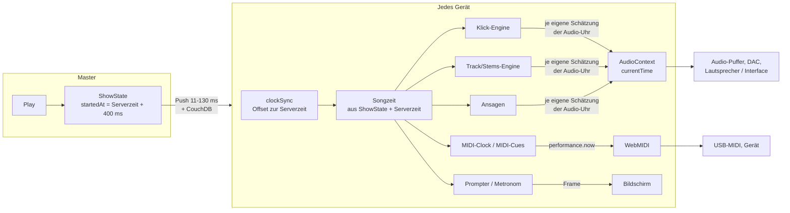

# 29 · Synchronität: eine Zeitbasis für alle Ausgänge und alle Geräte

Stand 2026-11-04. Konzept; die Zielzahlen (§1) sind beschlossen (Marco, 2026-11-04), der Rest ist noch kein Beschluss. Anlass: Messung mit dem Referenz-Song (#464) auf dem Fire - Klick und Track lagen nach jedem Play 0-55 ms auseinander (§3). Marco: „Die Synchronität aller Teile der App und über die Geräte hinweg ist der wichtigste Punkt der ganzen App. Alles soll an einer Zeitbasis hängen, nicht an verschiedenen."

Dieses Dokument beschreibt die ganze Signalkette, jede bekannte Abweichung mit gemessener oder abgeschätzter Größe, eine Worst-Case-Rechnung für heute und für das Ziel, das Konzept einer einzigen Zeitbasis, wie es auf der Bühne ohne ständige Kalibrierung zuverlässig bleibt, und wie wir es prüfen - nicht per Auge oder Gehör, sondern gemessen.

Verwandt: docs/09 (Uhr-Synchronisation zwischen Geräten), docs/13 §7 (Ausgabelatenz je Gerät), docs/19 (Track-Wiedergabe, Vorlauf), docs/21 (Timing-Klassen, Latenzmodell, Kalibrierung, Messungen §8), docs/24 (Rig-Check), docs/26 (Echtzeit-Budget, Stillstände).

---

## 1. Ziel

| Wo | Ziel (schlechtester Fall) | Warum diese Zahl |
|---|---|---|
| Ein Gerät, Ausgänge auf demselben Audio-Ausgang (Klick, Track, Stems, Ansagen) | **≤ 1 ms**, bei jedem Play gleich | Sie hängen am selben Hardware-Takt - jede Abweichung ist ein Fehler der Software. Hörbar wird ein Flam zwischen Klick und Drums ab etwa 5-10 ms. |
| Ein Gerät, Audio gegen MIDI (Clock, Cues) | **≤ 10 ms**, typisch ≤ 3 ms | Klasse `realtime` (docs/21 §2). Zum Vergleich: 1 ms ≈ 34 cm Schallweg; zwei Musiker 3 m auseinander hören sich ~9 ms versetzt. |
| Zwischen Geräten, gleiche Ausgabeart | **≤ 10 ms**, typisch ≤ 5 ms | WLAN-Uhrsynchronisation schafft heute ~±4 ms je Gerät (§3.1). |
| Bild (Prompter, Visueller Metronom) | kein eigenes Ziel, Klasse `soft` (≤ 100 ms, docs/21) | Marco, 2026-11-04: ein Bild genau ist nicht nötig. Das Bild rechnet trotzdem aus derselben Bandzeit. |

**Beschlossen (Marco, 2026-11-04):** die Zahlen für Ton und MIDI wie oben; für das Bild kein enges Ziel.

Und, ebenso wichtig wie die Zahlen: **es bleibt so** - über einen ganzen Gig, nach Pause/Play, nach einem App-Neustart, ohne dass jemand nachkalibriert. Wo das System eine Grenze nicht halten kann, sagt es das (Statusleiste), statt still daneben zu liegen.

---

## 2. Die Signalkette heute

Was zwischen „der Master tippt Play" und „der Klick ist im Ohr" passiert, für jedes Gerät:

Es gibt heute **vier Zeitbasen** auf jedem Gerät:

| Zeitbasis | Wer sie liest | Wie gut |
|---|---|---|
| **Serverzeit** (`getServerTime` = `Date.now` + Offset aus `clockSync`) | ShowState, Songzeit, Cue-Planer, MIDI-Clock, Abschnittssprünge, Show-Log | gut: Geräte treffen dieselbe Serversekunde auf ~0-8 ms (docs/21 §8.3) |
| **`performance.now()`** | WebMIDI-Zeitstempel (Cues, Clock), Stillstands-Monitor | gut: MIDI mit Zeitstempel ~0,3 ms (Median), schlimmstenfalls ~5 ms (docs/21 §8.1) |
| **Audio-Uhr `currentTime`** | Klick, Web-Audio-Track (Gig), Stems (Solo), Ansagen, Track-Pegel | **schlecht auf dem Fire:** springt in 64-192-ms-Schritten, also nur geschätzt |
| **`<audio>`-Element** | Timeline-Wiedergabe, alter Übungs-Player | eigene Uhr mit Nachführen per Seek; nicht im Gig |

Die Umrechnung Songzeit → Ausgang geschieht in **jeder Engine einzeln**: „Schlag 17 ist in 312 ms fällig, die Audio-Uhr steht gerade bei A, also bei A + 0,312 spielen, minus Ausgabelatenz." Das „steht gerade bei A" ist der Kern des Problems.

---

## 3. Abweichungen: Inventar mit Messwerten

Jede Abweichung hat eine **Art**, und die Art entscheidet, wie man sie behandelt:

- **konstant** (je Gerät/Ausgabeweg gleich, über Tage) → einmal messen, speichern, ausgleichen;
- **je Start** (bei jedem Play/App-Start/AudioContext anders, dann konstant) → muss die Software zur Laufzeit selbst bestimmen, Kalibrierung hilft nicht;
- **Zittern** (von Ereignis zu Ereignis) → klein halten, mitteln, Vorlauf;
- **Drift** (wächst mit der Zeit) → laufend nachführen.

### 3.1 Uhrsynchronisation zwischen Geräten (Serverzeit)

- `clockSync`: alle 60 s ein Burst von 7 Zeitabfragen, Auswahl nach kleinster Laufzeit, Korrektur asymmetrischer WLAN-Wege (docs/09).
- Gemessen (docs/21 §8.3): Versatz zur Serverzeit je Gerät +0,1 … +7,9 ms (Median), Streuung im Lauf ±1-2 ms. Innerhalb einer Sitzung konstant, zwischen Sitzungen wandert er um einige ms.
- Art: **je Sitzung** (Schätzfehler) + **Zittern** klein. Größe: **±4 ms je Gerät, ~8 ms zwischen zwei Geräten** (gemessen).

### 3.2 Ankunft des Play-Befehls

- Schneller Push 11-130 ms, CouchDB als zweiter Weg (docs/19 §6.1). Der Start liegt 400 ms in der Zukunft (`PLAY_LEAD_MS`), also kommt er normalerweise rechtzeitig an.
- Kommt er zu spät, steigt das Gerät an der richtigen Stelle ein (Songzeit aus `startedAt`), nur der Anfang fehlt - **kein Versatz**, sondern ein verspäteter Einstieg.
- Ausnahme: **Fortsetzen nach Pause** startet „jetzt" ohne Vorlauf (docs/19 §6.2) → jedes Gerät steigt ~0,1-0,2 s später ein, Position richtig.
- Art: kein Zeitfehler, solange die Songzeit aus der Serverzeit berechnet wird. Gehört aber zur Kette: Vorlauf muss größer sein als die längste Ankunft + längster Stillstand.

### 3.3 Abbildung Songzeit → Audio-Uhr (der heutige Hauptfehler)

- Web Audio nimmt nur Zeiten auf seiner eigenen Uhr (`currentTime`), die die Audio-Hardware zählt. Um „jetzt" in dieser Uhr zu kennen, liest die Software `currentTime` und vergleicht mit der Wanduhr.
- Gemessen 2026-11-04, je 300-400 Lesungen alle 10 ms:

| Gerät | `currentTime` springt in | Streuung `currentTime` gegen Wanduhr | `getOutputTimestamp()` Streuung |
|---|---|---|---|
| Fire HD 10 (WebView 138) | 64 ms, oft 128, selten bis 192 | **±28 ms** (5.-95. Perzentil), Extrem ±35-69 ms | ±0,4 ms (laufender Kontext), ±4-8 ms Sägezahn in den ersten Sekunden eines neuen Kontexts |
| Redmi Pad SE (WebView 156) | 11 ms | ±3 ms | ±0,3 ms, vereinzelt 5-ms-Spitzen |

- Heute glättet jede Engine selbst (`audioClock.ts`: Oberkante der letzten Lesungen). Ein frischer Glätter liest bis zu einen Schritt hinterher und erreicht die Oberkante erst nach Sekunden. Track und Stems setzten ihren bei jedem Play zurück.
- Gemessen (Referenz-Song, Klick und Track digital mitgeschnitten, Fire, Solo):

| Stand | Klick minus Track je Play |
|---|---|
| main | 0,9 / 2,9 / 18,9 / 48,9 ms (neu gestartet), 10-54 ms nach Pause → Play |
| PR #689 Schritt 1 (eine gemeinsame Uhr) | −11 … +7 ms |
| PR #689 Schritt 2 (Schätzung gehalten, warm gehalten) | 8 von 12 Starts ≤ 0,1 ms, 3 bei 3-8 ms, einer 23 ms (kurz nach App-Start) |

- Art: **je Start**. Größe heute (main): **bis ~55 ms gemessen, theoretisch bis eine Schrittweite (192 ms)** zwischen zwei Engines desselben Geräts. Gegen MIDI (das diese Schätzung nicht benutzt) ebenso.
- Vermutlich ist das auch der Grund, warum der Fire bei der Kalibrierung „selbst um ±18 ms schwankt" (docs/21 §8.6): gemessen wurde der Klick-Weg mit derselben Schätzung.

### 3.4 Ausgabelatenz (Software-Puffer bis Schall)

- Was geplant ist, kommt später aus dem Lautsprecher. Zwei Teile:
  1. **Puffer im Browser/OS** - genau der Abstand zwischen `currentTime` und dem, was `getOutputTimestamp()` als „gerade hörbar" meldet. Gemessen 2026-11-04 über 5 neue AudioContexts: Fire **363-364 ms**, Redmi **36 ms** - konstant je Gerät. (Der vom Browser gemeldete `outputLatency` springt dagegen: Fire 232-296 ms - unbrauchbar, wie schon docs/13 §7.)
  2. **Rest hinter dem gemeldeten Zeitpunkt** (DAC, Treiber, Lautsprecher, Interface) - akustisch gemessen gesamt Fire ~446 ms, Redmi ~72 ms (docs/21 §8.4/8.6); der Rest also grob Fire ~80 ms, Redmi ~36 ms. Erwartung: konstant je Gerät **und Ausgabeweg** (Lautsprecher, Kopfhörer, USB-Interface, Bluetooth).
- Art: **konstant je Gerät + Weg** (Teil 2), Teil 1 wird durch den Zeitstempel ohnehin erfasst. Größe der Unsicherheit nach Kalibrierung: Redmi ±1 ms, Fire heute ±18 ms (vermutlich §3.3).
- **Bluetooth**: Latenz 150-300 ms und nicht konstant (Codec, Funk) - für synchrone Ausgänge ungeeignet (docs/19).

### 3.5 Senden über WebMIDI

- Mit Zeitstempel: ~0,3 ms (Median), schlimmstenfalls ~5 ms, unabhängig von Last (docs/21 §8.1). USB-MIDI-Weg ~1 ms.
- Ohne Vorlauf (Senden „jetzt") bis 125 ms daneben → alles geht mit Zeitstempel und 200 ms Vorlauf (#477).
- Art: **Zittern**, klein. Nicht zurückholbar (`MIDIOutput.clear()` fehlt überall).

### 3.6 Stillstände des Hauptthreads

- Bis ~93 ms gemessen (docs/21 §8.2). Alles, was erst im letzten Moment geplant wird, kommt dann zu spät.
- Abgefangen durch Vorlauf: MIDI 200 ms, Audio 400 ms Start, Klick plant voraus.
- Art: **Zittern / Ausreißer**. Kein Versatz, solange der Vorlauf reicht; sonst einzelne verspätete Ereignisse.

### 3.7 Drift

- Die Audio-Hardware hat ihren eigenen Quarz; er läuft gegen die Systemuhr um einige ppm anders. Gemessen über 4 s: Fire −1,6 … −3,2 ms Wanderung der Zeitstempel-Abbildung in den ersten Sekunden eines Kontexts (Einschwingen), danach klein - **über einen ganzen Song noch nicht gemessen**.
- Gemessen über je 2 × 3 min (§10): Audio-Uhr gegen Systemuhr **Fire +256 / +263 ppm = ~15,5 ms pro Minute**, Redmi −115 / −40 ppm (2,4-7 ms pro Minute). Systemuhr gegen Serverzeit: Fire −44 / −60 ppm, Redmi −29 / −10 ppm (0,6-3,6 ms pro Minute).
- Heute: Klick und Track laufen auf der Audio-Uhr weiter; der Klick korrigiert ab 50 ms, Track/Stems ab 80 ms durch Neustart (hörbarer Sprung). Auf dem Fire wandern Klick und Track also gegen MIDI, Bild und die anderen Geräte um ~15 ms pro Minute, bis nach ~3 Minuten ein Sprung kommt. Die Uhrsynchronisation korrigiert nur den Offset alle 60 s - dazwischen bis ~3,6 ms Sägezahn.
- Art: **Drift**. Größe: bis an die Schwellen, also **bis 50-80 ms** vor einer Korrektur.

### 3.8 Bildschirm

- Bild kommt ein bis drei Frames nach dem Zeichnen (Compositor, Panel). Prompter/Metronom rechnen aus der Songzeit, nicht aus der Audio-Uhr. Gemessen: frühere 60-90-ms-„Lücken" im Foto-Vergleich waren Rendering, nicht Sync (docs/09 §5.3).
- Art: **konstant je Gerät** + Zittern um einen Frame. Klasse `soft`.

---

## 4. Worst-Case-Rechnung

Für ein Ereignis zur Bandzeit T hört man auf Gerät *d* über Ausgang *o*:

  **t_gehört = T + e_sync(d) + e_abb(d,o) + e_lat(d,o) + e_send(o) + e_drift(d,o)**

| Symbol | Was | heute (main) | nach diesem Konzept |
|---|---|---|---|
| e_sync | Uhrsynchronisation des Geräts | ±4 ms (gemessen) | ±2 ms (Ziel, §5.6) |
| e_abb | Abbildung auf die Uhr des Ausgangs | Audio: 0 … −192 ms je Engine und Start (bis 55 gemessen); MIDI: ~0 | ≤ 1 ms, für alle Audio-Ausgänge **dieselbe** |
| e_lat | Restfehler der Latenz-Kalibrierung | Fire ±18 ms, Redmi ±1 ms | ±5 ms Fire, ±1 ms Redmi (Ziel; zu messen) |
| e_send | Senden | Audio 0 (sample-genau), MIDI 0,3 / 5 ms | gleich |
| e_drift | Drift bis zur nächsten Korrektur | bis 50 (Klick) / 80 ms (Track); Fire ~15 ms/min gemessen | ≤ 1 ms (laufend nachgeführt) |

**Schlechtester Fall, heute (main), Fire:**

| Paar | Rechnung | Ergebnis |
|---|---|---|
| Klick ↔ Track, selbes Gerät | zwei unabhängige e_abb (0 … 64, Fire meist) + Drift-Differenz bis 80 | **gemessen 55 ms**, theoretisch > 100 ms |
| Klick ↔ MIDI-Clock, selbes Gerät | e_abb bis 64 (warm) / 192 (kalt) + e_lat 18 + e_send 5 | **~90 ms** (warm), mehr kalt - gerechnet, nicht gemessen |
| Fire-Klick ↔ Redmi-Klick | e_sync 8 + e_abb 64 + 16 + e_lat 18 + 1 | **~105 ms** - gerechnet |

**Schlechtester Fall, nach diesem Konzept:**

| Paar | Rechnung | Ergebnis |
|---|---|---|
| Klick ↔ Track, selber Ausgang | gleiche Abbildung, gleiche Latenz → nur Rundung | **≤ 1 ms** |
| Klick ↔ MIDI-Clock, selbes Gerät | e_abb 1 + e_lat 5 + e_send 5 | **≤ 11 ms**, typisch ~2 |
| Klick Gerät A ↔ Klick Gerät B | e_sync 2+2 + e_abb 1+1 + e_lat 5+1 | **≤ 12 ms**, typisch ~4 |
| MIDI Gerät A ↔ MIDI Gerät B | e_sync 4 + e_send 5+5 | **≤ 14 ms**, typisch ~2 |

Die größten Posten danach sind die Latenz-Kalibrierung des Fire und das MIDI-Senden im schlechtesten Fall - beides misst der Rig-Check (§7), und beide sind keine Software-Fehler, sondern Eigenschaften der Hardware.

---

## 5. Konzept: eine Zeitbasis

### 5.1 Grundsatz

**Die Bandzeit (= Serverzeit) ist die einzige Zeitbasis.** Jedes Ereignis - Klick, Track-Position, Stem, Ansage, MIDI-Clock-Tick, Cue, Lichtwechsel, Prompter-Zeile - wird als „passiert zur Bandzeit T" beschrieben. Nichts plant „jetzt + x" und keine Engine liest selbst eine Uhr.

### 5.2 Ein Zeitdienst je Gerät

Ein Modul (`lib/timeBase.ts`, Name offen) hält die einzigen Abbildungen des Geräts und ist der einzige Ort, der Uhren liest:

1. **Bandzeit ↔ `performance.now()`** - aus `clockSync` (Offset, mit Drift-Steigung statt nur Offset).
2. **`performance.now()` ↔ Audio-Uhr** - aus `AudioContext.getOutputTimestamp()`: die Hardware nennt, welcher Moment der Audio-Uhr gerade hörbar ist und wann das in `performance.now()` war. Durch viele Paare der letzten Sekunden eine Gerade legen (Offset + Steigung) - das glättet den Sägezahn und misst die Drift, statt sie zu entdecken.
3. **Puffer-Abstand** `currentTime` − hörbar (Fire 364, Redmi 36 ms) - nur zur Plausibilität und als Rückfallebene; gespeichert wird er nicht.

Daraus bietet er genau drei Funktionen an:

- `audioTimeFor(bandTimeMs, output)` - wann auf der Audio-Uhr planen, damit es zur Bandzeit **am Ausgang hörbar** ist (minus Restlatenz des Ausgabewegs, §5.4);
- `midiTimestampFor(bandTimeMs, output)` - der `performance.now()`-Zeitstempel für WebMIDI (minus Latenz des MIDI-Geräts);
- `songAt(bandTimeMs)` / `bandTimeOf(songMs)` - die Songzeit aus dem Transport (heute verstreut über `computeActiveMs`, Rate, Sprünge).

Click, Track, Stems, Ansagen, Track-Pegel, MIDI-Clock, MIDI-Cues und die Bildanzeige rufen nur diese. Ein Wächter-Test (wie `components/ui/guard.test.ts`) verbietet `currentTime`, `getOutputTimestamp`, `Date.now()` und `performance.now()` zum Planen außerhalb des Zeitdiensts.

### 5.3 Folgen für die Engines

- Alle Audio-Ausgänge eines Geräts benutzen dieselbe Abbildung im selben Moment → Klick ↔ Track ist **durch Bauart** gleich, nicht durch Glück beim Anker.
- Audio und MIDI hängen beide an `performance.now()` → ihre relative Lage ist nur noch die gespeicherte Latenz beider Wege.
- Kein Engine-Neustart mehr wegen „Uhr daneben": Abweichungen durch Drift werden **weich** nachgeführt (§5.5).

### 5.4 Latenz: was konstant ist, wird einmal gemessen

- Gespeichert wird nur der **Rest hinter dem hörbaren Zeitpunkt** je Gerät und Ausgabeweg (Lautsprecher, Kopfhörer, USB-Interface je Kanal, HDMI). Er ist konstant; der variable Teil (Puffer je AudioContext) steckt im Zeitstempel und wird zur Laufzeit erfasst.
- Ausgabewege erkennt die App schon (`useAudioRouteStore`); ein Weg ohne gespeicherten Wert gilt als „nicht eingemessen" und wird so angezeigt.
- Bluetooth ist für synchrone Ausgänge gesperrt bzw. deutlich gewarnt (nicht konstant, §3.4).
- Bisherige Werte (Fire 446, Redmi 72, Handy 67 ms) wurden auf der wackelnden Schätzung gemessen und werden nach Schritt 1 neu gemessen.

### 5.5 Drift weich nachführen

- Die Steigungen aus §5.2 (Audio-Quarz gegen Systemuhr, Systemuhr gegen Serverzeit) werden laufend gemessen.
- Track und Stems: kleine Abweichung → Wiedergaberate für einige Sekunden um höchstens 0,1 % anpassen (1,7 Cent, unhörbar) statt Neustart. Neustart nur noch bei echten Sprüngen (Seek, > 50 ms).
- Klick und MIDI-Clock: jeder nächste Schlag/Tick wird ohnehin neu aus der Bandzeit gerechnet - Drift kommt gar nicht erst zustande.

### 5.6 Uhrsynchronisation zwischen Geräten verbessern

- Ziel ±2 ms je Gerät statt ±4: Bursts öfter, solange gespielt wird (z. B. alle 15 s), Drift-Steigung zwischen Bursts statt Sprung, Qualität (Laufzeit, Streuung) als Wert im Zeitdienst.
- Wechselt der Offset zwischen zwei Bursts um mehr als ein paar ms, wird er über einige Sekunden eingeblendet statt zu springen.

### 5.7 Selbstüberwachung statt Daueraufsicht

Der Zeitdienst weiß zu jedem Zeitpunkt, wie gut er ist, und meldet es:

| Zustand | Bedingung (Vorschlag) | Anzeige |
|---|---|---|
| gut | Uhrsync ≤ 3 ms Unsicherheit, Zeitstempel-Gerade Rest ≤ 1 ms, Weg eingemessen | nichts |
| eingeschränkt | Uhrsync schlechter, Weg nicht eingemessen, Zeitstempel fehlt (Rückfall auf Glätter) | gelb im Sync-Status |
| Fehler | Uhrsync verloren, Bluetooth als Taktgeber | rot (nur echte Fehler, docs/15/Statusleiste) |

---

## 6. Auf der Bühne: zuverlässig ohne ständige Kalibrierung

| Was | Wann | Aufwand |
|---|---|---|
| Restlatenz je Gerät + Ausgabeweg messen | einmal je neuem Gerät / neuem Weg (Interface, Kopfhörer) | Rig-Check „Messen" (~1 min, Mikrofon oder Interface-Eingang) |
| Puffer je AudioContext, Drift, Uhrsync | laufend, automatisch | keiner |
| Kurzprüfung | beim Soundcheck, optional | Rig-Check Kurzcheck (~30 s): prüft gegen gespeicherte Werte, meldet nur Abweichungen > 3 ms |
| Weg wechselt mitten im Gig (Kopfhörer raus) | automatisch erkannt | gespeicherter Wert dieses Wegs, sonst gelb |

Die Musiker sehen davon im Normalfall nichts.

---

## 7. Prüfen: messen statt hören

Vier Ebenen, jede mit Abnahmezahlen. Jeder Schritt in §8 wird vorher und nachher auf derselben Ebene gemessen.

1. **Simulation (CI):** Unit-Tests mit nachgebildeten Uhren - Sprünge in 64/128/192-ms-Schritten, Sägezahn des Zeitstempels, Drift ±100 ppm, ausgesetzter Kontext, Stillstände bis 150 ms. Prüft: alle Ausgänge planen dasselbe Ereignis auf dieselbe Bandzeit (≤ 0,1 ms in der Simulation). Plus Wächter-Test (§5.2).
2. **Digitaler Mitschnitt im Gerät (ohne Mikrofon):** die Methode vom 2026-11-04 - jeder Audio-Ausgang wird vor dem Mischer abgegriffen, die Zeitstempel jeder MIDI-Nachricht werden mitgeschrieben, alles gegen die Bandzeit des Referenz-Songs ausgewertet. Erfasst die ganze Software-Kette bis zum Puffer. Wird als Diagnose eingebaut („Synchronität dieses Geräts", ~30 s), Ergebnis je Ausgang in ms.
3. **Elektrisch/akustisch (UMC204HD):** Audio-Ausgang des Tablets in Eingang 1, MIDI über ein Gerät, das MIDI hörbar macht (z. B. Kemper-Clock-Blinken per Fotodiode, oder ein MIDI-zu-Audio-Wandler), oder ein zweites Tablet in Eingang 2. Der Laptop ist der Stage-Server, seine Uhr ist die Bandzeit - jede Ankunft direkt gegen den Sollzeitpunkt (Verfahren docs/21 §8). Prüft die Restlatenz je Weg und **Gerät gegen Gerät**.
4. **Vor dem Gig:** Rig-Check-Messrunde (#662) mit Ergebnis je Gerät und Ausgang, grün/gelb/rot gegen die Ziele aus §1.

---

## 8. Schritte

| # | Schritt | Abnahme |
|---|---|---|
| 0 | **Bestandsaufnahme:** auf allen Geräten (Fire, Redmi, Xiaomi-Handy, Laptop-Chrome, später Windows) `currentTime`-Schritte, Qualität von `getOutputTimestamp()` über Minuten, Puffer-Abstand über App-Neustarts und Ausgabewege, Uhrsync-Streuung über eine Stunde, Drift. | Tabelle je Gerät; Entscheidung, ob der Zeitstempel überall trägt |
| 1 | **Zeitdienst** (§5.2) bauen, alle Engines umstellen, Wächter-Test. Glätter aus #689 bleibt als Rückfallebene für Geräte ohne brauchbaren Zeitstempel. | Ebene 2: Klick ↔ Track ≤ 1 ms bei 20 Starts auf Fire und Redmi; Audio ↔ MIDI-Zeitstempel konstant ±1 ms |
| 2 | **Drift weich nachführen** (§5.5), Schwellen-Neustarts entfernen. | Ebene 2 über einen 10-min-Lauf: Abweichung nie > 2 ms, kein Neustart |
| 3 | **Restlatenz neu messen** je Gerät und Weg, Speicherung je Weg, „nicht eingemessen"-Anzeige. | Ebene 3: wiederholte Messung je Gerät streut ≤ ±3 ms (Fire heute ±18) |
| 4 | **Geräte untereinander:** Uhrsync verbessern (§5.6), Ebene 3 mit zwei/drei Tablets. | Gerät ↔ Gerät ≤ 10 ms im schlechtesten von 20 Starts |
| 5 | **Diagnose und Rig-Check** (§7 Ebene 2 + 4), Zustandsanzeige (§5.7). | Rig-Check zeigt je Gerät/Ausgang ms und Ampel |

PR #689 (gemeinsame Audio-Uhr) ist eine Zwischenlösung: er macht die heutige Schätzung gemeinsam und ruhig (8 von 12 Starts exakt, schlechtester 23 ms) und bleibt nach Schritt 1 als Rückfallebene.

---

## 9. Offene Fragen

1. ~~Zielzahlen~~ - beschlossen (§1): Ton/MIDI wie vorgeschlagen, Bild ohne enges Ziel.
2. **Fire als Audio-Gerät:** 364 ms Puffer + ~80 ms Rest - zulässig, solange eingemessen, oder nur als Anzeige-Gerät?
3. **Bluetooth:** für Klick/Track sperren oder nur warnen?
4. **Verhalten bei schlechter Qualität** (§5.7): nur anzeigen, oder ein Gerät, das die Grenze nicht hält, automatisch vom Audio-Taktgeben ausnehmen?
5. **Fortsetzen nach Pause** (docs/19 §6.2): mit Vorlauf wie beim Start, damit auch dort alle Geräte gemeinsam einsetzen?

---

## 10. Bestandsaufnahme (Schritt 0), 2026-11-04

Dev-App 1.694 auf beiden Tablets, eigener AudioContext mit stummem Oszillator, je zwei Läufe à 3 min parallel auf beiden Geräten: alle 10 ms `getOutputTimestamp()`, `currentTime`, `performance.now()`, `Date.now()`; alle 2 s `GET /time` am Stage-Server (wie `clockSync`). Skript im Scratchpad der Sitzung (`survey.js`), Auswertung im Gerät.

| | Fire HD 10 (Android 9, WebView 138) | Redmi Pad SE (Android 16, WebView 156) |
|---|---|---|
| Zeitstempel-Paare je Sekunde | 16,5 (alle ~60 ms) | 88-91 (alle ~11 ms) |
| Rest um eine 2-s-Gerade (Median / 95 % / 99 % / max) | 0,3 / 6,2 / 10,9 / **68** ms (in beiden Läufen gleich) | 0,25 / 0,6-0,8 / 1,7-4,7 / 5-11 ms |
| Drift Audio-Uhr gegen `performance.now()` | **+256 / +263 ppm** | −115 / −40 ppm |
| `currentTime`-Schritte | meist 64 ms, oft 128, bis 232 | meist 8 ms, selten 16-152 |
| `currentTime` Streuung (5.-95. %) | −97 … +34 / −36 … +31 ms | −32 … +3 / −4 … +7 ms |
| Puffer-Abstand (`currentTime`-Kante − hörbar), je 2-s-Fenster | 310-379 / 276-332 ms - **wandert** | 15-46 / 32-38 ms |
| `Date.now()` gegen `performance.now()` | 0 ppm, Sprünge < 1 ms | 0 ppm, Sprünge < 1 ms |
| `/time` Laufzeit (min / Median / 95 % / max) | 13 / 28 / 44 / 50 und 22 / 35 / 59 / 158 ms | 13 / **106** / 135 / 370 und 24 / 32 / 49 / 107 ms |
| bester Offset je 30 s (Wanderung im Lauf) | −6321 … −6328 / −6330 … −6336 ms | 337,5 … 336,5, dann **294** / 338,5 … 341 ms |
| Drift Systemuhr gegen Serverzeit | −44 / −60 ppm | −29 / −10 ppm |

Folgerungen:

1. **`getOutputTimestamp()` trägt auf beiden Geräten** - beim Redmi sehr gut, beim Fire mit weniger und verrauschteren Paaren und gelegentlichen 68-ms-Ausreißern. Der Zeitdienst braucht deshalb eine **robuste** Gerade (Ausreißer verwerfen, mehrere Sekunden Fenster). Ob der Median-Rest von 0,3 ms der echten Genauigkeit entspricht, zeigt erst die akustische Messung (Schritt 3).
2. **`currentTime` ist auf dem Fire als Grundlage unbrauchbar:** selbst die Oberkante wandert gegen das Hörbare um ~50-70 ms innerhalb eines Laufs. Die heutige Glättung (auch #689) hat damit eine Grenze, die keine Feineinstellung überwindet.
3. **Drift ist groß und muss laufend nachgeführt werden:** Fire-Audio ~15,5 ms pro Minute gegen die Systemuhr - über einen 4-min-Song über 60 ms. Die Steigung ist je Gerät stabil (zweimal gemessen), also messbar und ausgleichbar.
4. **Die Uhrsynchronisation braucht eine Steigung und ein Qualitätsmaß:** die Systemuhren laufen 10-60 ppm gegen den Server (bis 3,6 ms pro Minute). Bei schlechtem WLAN (Redmi, erster Lauf: Median-Laufzeit 106 ms) wählte das Verfahren „kürzeste Laufzeit je 30 s" einmal einen um 43 ms falschen Offset - genau so ein Sprung darf nicht übernommen werden (§5.6, §5.7).
5. Systemuhr und `performance.now()` laufen gleich (0 ppm, keine Sprünge) - `performance.now()` als gemeinsame Mittelachse im Gerät ist richtig.

Noch offen für Schritt 0: Xiaomi 14T Pro und Laptop-Chrome (nicht angeschlossen), längere Läufe (eine Stunde), Ausgabewege Kopfhörer/USB-Interface, und wie konstant der Rest hinter dem Zeitstempel über App-Neustarts ist (braucht die akustische Messung, Schritt 3).

---

## 11. Vorher/Nachher-Messung

Damit jede Stufe gegen dieselbe Messung verglichen wird: **ein festes Protokoll**, `scripts/sync-bench/` (README dort), Rohdaten unter `~/stageboard-data/sync-bench/<Datum>-<Stand>/`, die verwendeten Apps daneben.

**Protokoll:** Fire und Redmi gleichzeitig, Solo üben, Referenz-Song (#464), Klick an. Je Gerät 3 Starts aus Stopp, 9 Starts aus Pause, je 8 s, danach der ganze Song (2:11) ohne Pause. Gemessen wird digital in der App (jede Quelle vor dem Mischer abgegriffen, Einsätze mit exakter Audio-Uhr-Position), umgerechnet über die Ausgabe-Zeitstempel auf den Zeitpunkt, an dem der Ton hörbar wird, und mit der Songzeit am Referenz-Schlag verglichen.

**Kennzahlen:** wie weit die Lage gegen die Songzeit **von Start zu Start** schwankt (das ist, was MIDI, Bild und die anderen Geräte trifft), der größte Abstand **Klick ↔ Track**, die **Drift** über einen ganzen Song. Absolutwerte nicht vergleichen (enthalten weder den Rest nach dem Zeitstempel noch eine Latenz - die Dev-App hat eine eigene Geräte-ID).

### Ergebnisse 2026-11-04

| Gerät | Stand | gegen Songzeit, Schwankung über 12 Starts (Klick / Track) | Klick ↔ Track, größter je Start | im ganzen Song: Klick ↔ Track | Drift über den Song |
|---|---|---|---|---|---|
| Fire | **vorher** (main) | 64 / 74 ms | 59 ms | 50 ms (Klick sprang nach 12 s um +51 ms) | keine |
| Fire | #689 (eine geglättete Uhr) | 26 / 68 ms | 42 ms (erster Start nach App-Start) | 0 ms | keine |
| Fire | **Schritt 1** (Zeitdienst) | 14 / 14 ms - **11 von 12 Starts innerhalb ±0,5 ms**, einer 13 ms daneben | **1,0 ms** | 0,2 ms | keine |
| Redmi | **vorher** (main) | 5 / 5 ms | 2,7 ms | 0,3 ms | **+15,7 ms/min** |
| Redmi | #689 | 22 / 23 ms (Drift trägt über Pausen weiter, dann Sprung) | 2,1 ms | 0 ms | +14,8 ms/min |
| Redmi | **Schritt 1** | **1,2 / 1,3 ms** | **0,8 ms** | 0,1 ms | +14,8 ms/min |
| Fire | **Schritt 2** (Drift nachgeführt) | **0,8 / 0,9 ms** | **0,6 ms** | 0,1 ms | keine |
| Redmi | **Schritt 2** | **0,8 / 1,0 ms** | **0,4 ms** | 0,0 ms | **0,0 ms/min** (Streuung über den Song 0,1 ms, vorher 9,8) |
| Xiaomi 14T Pro (Handy) | **Schritt 2** (nur nachher gemessen) | **1,0 / 0,9 ms** | **0,7 ms** | 0,0 ms | keine (Streuung über den Song 0,1 ms) |

Gelesen:

- **Schritt 1 erreicht das Ziel „gleicher Ausgang ≤ 1 ms" für Klick ↔ Track auf beiden Geräten**, bei jedem Start. Die Schwankung gegen die Songzeit ist beim Redmi von 5 auf 1,2 ms, beim Fire von 74 ms auf ±0,5 ms (11 von 12) gefallen.
- **Offen in Schritt 1:** ein Start auf dem Fire lag 13 ms neben den anderen - vermutlich eine bestätigte Neuberechnung der Geraden in einer Phase mit vielen Fire-Ausreißern. Nachschärfen: längeres Fenster für die Steigung, mehr Bestätigungen.
- **Drift ist unverändert** (Redmi +15 ms pro Minute gegen die Songzeit, Klick und Track gemeinsam): die Engines laufen nach dem Anker in reiner Audio-Zeit weiter. Das ist Schritt 2. Der Zeitdienst misst die Rate der Audio-Uhr inzwischen live - in der App auf dem Redmi −247 ppm, auf dem Fire −5 ppm (in frischen Test-Kontexten bei der Bestandsaufnahme waren es andere Werte: die Rate gehört zum jeweiligen AudioContext und muss gemessen, nicht angenommen werden).
- #689 allein verbessert Klick ↔ Track, verschlechtert aber die Lage gegen die Songzeit von Start zu Start (gehaltene Schätzung, Drift trägt weiter) - als Zwischenstand ohne Schritt 1 nicht empfehlenswert.

- **Schritt 2** (Drift weich nachgeführt: gemessene Rate vorwärts eingespeist, Rest über 8 s gezogen, Klick folgt je Schlag um ≤ 1 ms) **beseitigt die Drift** - Redmi 0,0 ms/min statt 15,7, über einen ganzen Song 0,1 ms Streuung. Damit hält Solo auf beiden Geräten bei jedem Start und über den ganzen Song **≤ 1 ms**, Klick ↔ Track ≤ 0,6 ms. Der 13-ms-Ausreißer des Fire aus Schritt 1 kam in diesem Lauf nicht vor (12 Starts sind eine kleine Stichprobe - weiter beobachten).

Noch nicht gemessen: Gig (der Web-Audio-Track hat dieselbe Regel, eine Gig-Messung bewegt aber den Show-Zustand der ganzen Band), MIDI-Clock (kein MIDI-Gerät angeschlossen), Gerät gegen Gerät (Schritt 4). Nach Schritt 3 (Latenz je Weg) wird dieselbe Messung wiederholt und hier angehängt.

### Gig über zwei Geräte, nach Schritt 2 (2026-11-04)

Test-Band, Redmi ist Master. Die Band leitet den **Klick auf den Fire und den Track auf das Redmi** - genau der Bühnenfall „Klick und Track auf verschiedenen Geräten". Jedes Gerät nimmt auf, misst seinen eigenen Abstand zur Serverzeit (`/time` je Sekunde, unabhängig von `clockSync`), die Pushes des Masters liefern den Transport in Serverzeit; `scripts/sync-bench/gig-analyze.mjs`. 3 Starts aus Stopp, 6 aus Pause, dann der ganze Song.

| | je Take (Streuung im Take) | über die Starts | ganzer Song |
|---|---|---|---|
| Fire-Klick gegen Band-Uhr | 0,2-3 ms | 233-240 ms, einmal 250 | **228-229 ms über 2 min (±0,7)** |
| Redmi-Track gegen Band-Uhr | 0,1-0,7 ms | 30-37 ms, dann 42-43 | wandert zweimal weich um 12-15 ms (44 → 28 → 42) |
| Klick (Fire) − Track (Redmi) | 0,3-3 ms | 190-218 ms | folgt dem Redmi |

Gelesen:

- **Die Audio-Seite hält auch im Gig:** innerhalb eines Takts und über den ganzen Song steht der Fire-Klick auf ±0,7 ms zur Band-Uhr.
- **Der Rest ist die Uhrsynchronisation (Schritt 4):** die eigene Messung des Abstands zur Serverzeit war je Take auf ±3 ms stabil, der Redmi-Track sprang aber zweimal um 12-15 ms - jedes Mal, als `clockSync` seinen Offset neu setzte; der Track folgte weich über die Rate (kein Knacken), die Band-Zeit selbst stand aber nicht still. Ebenso der Fire bei einem Take (+17 ms, danach zurück). Mit 142 Proben über denselben Song streute die unabhängige Schätzung nur 2 ms - die Synchronisation kann also viel genauer sein, als sie heute ist (ein Burst von 7 Proben alle 60 s, kleinste Laufzeit gewinnt).
- **Der konstante Abstand Fire-Klick ↔ Redmi-Track (~200 ms)** ist der nicht ausgeglichene Ausgabepuffer des Fire: die Dev-App hat eine eigene Geräte-ID ohne gespeicherte Latenz. Das ist Schritt 3, nicht die Zeitbasis.
- Nebenbefund: beide Tablets zeigten gleichzeitig „Dieses Gerät hat das Master-Token" - prüfen.

**Damit ist Schritt 4 (Uhrsynchronisation) der nächste große Hebel:** Ziel ±2 ms je Gerät; Offset nicht springen lassen, sondern einblenden; mehr Proben, Qualität messen, Ausreißer bei schlechtem WLAN verwerfen (§5.6).

### Schritt 4: Uhrsynchronisation (2026-11-04)

**Wiederholung auf denselben Daten:** 10 min Rohproben auf Fire, Redmi und Xiaomi-Handy gleichzeitig (eine `/time`-Probe je Sekunde plus der Burst von 7 jede Minute), beide Verfahren nachgerechnet, verglichen mit einer Geraden durch die schnellsten 10 % der ganzen Aufnahme (`scripts/sync-bench/clock-replay.mjs`):

| Fehler der Band-Zeit | alt (Burst je Minute, sofort übernommen) | neu (laufend, Gerade über 2 min, weich nachgeführt) |
|---|---|---|
| Fire | Median 5,6 · 95 % 16,9 · max 18,3 ms, Sprünge bis 21 ms | **Median 0,5 · 95 % 1,4 · max 2,3 ms** |
| Redmi | 7,3 · 16,7 · 16,7 ms, Sprünge bis 22 ms | **0,6 · 1,9 · 2,4 ms** |
| Handy | 6,2 · 7,0 · 11,1 ms, Sprünge bis 9 ms | **1,0 · 1,8 · 2,2 ms** |

Ziel ±2 ms je Gerät: erreicht (95 %). Grenze der Aussage: die Referenz nutzt dasselbe Prinzip (kürzeste Laufzeiten) - eine dauerhaft einseitige WLAN-Strecke sähe auch sie nicht; das zeigt erst die Messung Gerät gegen Gerät mit dem Interface.

**Solo nach Schritt 4 (Dev 1.704, mit Laptop-Browser als viertem Gerät):** Beim Messen kam eine Schwäche aus Schritt 1 heraus: der Puffer-Abstand wurde nach 5 s geschätzt und dann gehalten - auf dem Fire je App-Start bis ~30 ms daneben (einmal 230, einmal 262 ms), und eine spätere Korrektur kam auf einmal. Behoben (98. Perzentil über 30 s, bereit nach 20 s, Totband 3 ms, sonst höchstens 1 ms pro Sekunde in beide Richtungen):

| Gerät | vorher (main) | nach Schritt 4 |
|---|---|---|
| Fire | Schwankung 64 / 74 ms, Klick ↔ Track 59 ms | in den ersten ~2 min nach App-Start gleitet die Lage weich um ~30 ms ein, danach **±0,5 ms** (Takes 6-10, ganzer Song 238-241 ms) |
| Redmi | 5 / 5 ms, 2,7 ms, Drift 15,7 ms/min | **0,5 / 0,8 ms, 0,5 ms, Drift 0** |
| Laptop (Chrome, ist selbst der Stage-Server) | 9,4 / 9,9 ms, Klick ↔ Track 6,8 ms | **2,5 / 3,8 ms, 2,6 ms** |

Offen: das Einschwingen des Fire nach dem App-Start (welcher Wert ist richtig, und warum ändert er sich die ersten Minuten?) - klärt die akustische Messung (Schritt 3); die Gig-Messung über die Geräte mit der neuen Synchronisation; das Handy mit 1.704.

### Gig nach Schritt 4: Band-Uhr über die Geräte (2026-11-04)

Wie die Gig-Messung nach Schritt 2: Redmi ist Master und spielt den Track, der Fire den Klick (so bindet die Band die Ausgänge; Handy und Laptop haben im Gig keinen Ausgang und hören nichts). 3 Starts, 6 × Pause → Play, danach 6 weitere Starts und der ganze Song. Jedes Gerät gegen die Band-Uhr über seine eigenen `/time`-Proben, unabhängig von der App.

**Erster Lauf mit Dev 1.704 - der Redmi viel besser, der Fire schlechter:** Der Fire-Klick bog sich innerhalb eines Takes um bis zu 35 ms (Schlagabstand 501,9 statt 500 ms). Ursache: die Ausgabe-Zeitstempel des Fire liegen etwa alle 25 s für 0,1-5 s ~24 ms daneben (dabei ~1000 ppm Drift) und springen zurück - die erste, ungefilterte Ausgleichsgerade des Zeitdienstes kippte dadurch auf ±1500 ppm. Uhrsync, Wanduhr und Puffer-Abstand standen dabei still (je ±1 ms gemessen). Zweitens: bei jedem Stop liefert der Fire ein, zwei Paare bis 251 ms daneben; eines über 250 ms startete den Zeitdienst neu - 20 s Ersatz-Uhr, danach 5 ms anderer Puffer-Abstand. Beides behoben (#692): mit einer Geraden zählen nur Paare nahe an ihr, erst wenn 80 % der letzten 10 s daneben liegen, hat sich die Uhr wirklich bewegt; Neustart erst, wenn die Uhr 0,5 s lang daneben liegt; der Puffer-Abstand misst nicht, solange das neueste Paar daneben liegt.

| Gig | Fire-Klick: Streuung über Starts | Fire-Klick: Schwankung im Take (sd) | Redmi-Track: Streuung über Starts | Klick ↔ Track: Streuung | Redmi ganzer Song (sd) |
|---|---|---|---|---|---|
| nach Schritt 2 (1.700) | 16,9 ms | bis 3,1 ms | 12,3 ms | 27,5 ms | 5,7 ms |
| Schritt 4, 1.704 | 23,7 ms | bis 9,0 ms | 3,2 ms | 25,1 ms | 1,1 ms |
| **Schritt 4, 1.706** | **4,7 ms** (die 6 Starts am Ende: 2,1 ms) | **0,2-0,5 ms** | **4,4 ms** | **6,9 ms** | **0,7 ms** |

Ohne t09 (Tempo-Sprung des Referenz-Songs, in allen Läufen gleich) und ohne den Redmi-Take t04 von 1.706: dessen eigene Zeitproben kamen alle langsam zurück (≥ 88 ms statt 12 ms) und lagen 33 ms daneben - ein Messfehler der 10-s-Auswertung, nicht der App. Im Fire-Wert von 4,7 ms stecken noch die letzten 2,8 ms Einschwingen nach dem App-Start (bei ~1 min des Laufs, 3,5 min nach dem Start). Der Zeitdienst des Fire war in 6 min Messung nie ausgefallen, seine Rate blieb zwischen −32 und +37 ppm.

- **Ziel „zwischen Geräten ≤ 10 ms“:** erreicht (6,9 ms Streuung Klick ↔ Track, schlechtester Take).
- **Der konstante Abstand Fire-Klick ↔ Redmi-Track (~200 ms)** ist weiter der nicht ausgeglichene Ausgabepuffer des Fire (Dev-App ohne gespeicherte Latenz) - Schritt 3.
- Einzelbefund: in 1 von 20 Pause → Play kam der erste Klick des Fire 16 ms zu spät, danach stimmte er. Ein Fortsetzen hat anders als ein Start keinen Vorlauf (`playbackAccumulatedMs` ohne −400) - der erste Schlag kann schon fällig sein, wenn die Nachricht ankommt. Beobachten.
- Offen: das Einschwingen des Fire in den ersten Minuten (Schritt 3), Handy und Laptop mit hörbarem Ausgang im Gig.

### Klick und Track auf mehreren Geräten gleichzeitig (2026-11-04/05)

Mit #695 spielt jeder angehakte Ausgang auf allen gewählten Tablets. Gemessen mit Fire, Redmi und Laptop-Browser, alle drei mit Klick und Track (Handy noch auf 1.700, stumm). Jede Messung: 3 Starts, 6 × Pause → Play, 9 weitere Starts, ganzer Song; jedes Gerät über seine eigenen Ausgabe-Zeitstempel und `/time`-Proben gegen die Band-Uhr (`scripts/sync-bench`, `gig-multi.mjs`).

**Unter der zusätzlichen Last zeigten die Zeitstempel weitere Fehler** – jeder führte zu einer Änderung des Zeitdienstes (#692) und zu einem Test; nachgerechnet wurde jede Version mit den aufgezeichneten Zeitstempeln aller Geräte (`tb-replay.mts`):

| Dev | Befund | Änderung |
|---|---|---|
| 1.707 | Fire: Ausreißer-Strecke 10 s (−17 → −32 ms), länger als die 8 s für „wirklich bewegt“ – übernommen und zurück, Klick und Track ~40 ms hin und her | Verschiebung nur bei gleicher Rate |
| 1.708 | Fire: Ausreißer kroch langsam herein (0 → −22 ms über 16 s), unter der 3-ms-Schranke kippte die Gerade auf −1300 ppm, Zeit 68 ms daneben | Gerade an der Oberkante, Rate langsam |
| 1.709 | Fire gut; Redmi: jedes zehnte Paar 5 ms spät, die Oberkante sprang um 5 ms | Gerade durch das dichteste 4-ms-Band |
| 1.710 | Fire: Rate aus den ersten Sekunden bei −1200 ppm, durfte nur 1 ppm/s nachgeben – Lesung sägte ±5 ms | Rate = Median der Fenster-Raten über 2 min |
| **1.711** | **Fire-Zeitdienst −4…+3 ms, Rate −1…+2 ppm, nie ausgefallen** | – |

**Ergebnis 1.711 (ohne t09 = Tempo-Sprung des Referenz-Songs, ohne Takes mit langsamen eigenen Zeitproben):**

| | Streuung über Starts | Schwankung im Take (sd) |
|---|---|---|
| Fire Klick / Track | 6,5 / 6,2 ms | 0,1–0,7 ms (zwei Takes 2,9) |
| Redmi Klick / Track | 5,4 / 5,0 ms | 0,1–0,5 ms (einzelne 2,5–5,3) |
| Laptop Klick / Track | 2,0 / 2,8 ms | 0,1–0,7 ms |
| Gerät gegen Gerät (gleicher Schlag) | 4,4–7,2 ms | max 0,4–6,0 ms |

Ziel „zwischen Geräten ≤ 10 ms“: nach den Zeitstempeln erreicht.

**Aber: was zu hören ist (Laptop-Mikrofon, 2026-11-05).** Marco hat alle Geräte zusammen angehört: Redmi, Laptop und Handy passen, der Fire liegt hörbar daneben. Messung: UMC vom Redmi abgezogen (sonst spielt der Redmi über das Interface, nicht den Lautsprecher), Klick auf Fire und Redmi, Laptop-Mikrofon, nach ~18 s der Redmi abgehakt (so ist klar, welcher Klick welcher ist). Beide Geräte stehen im Take auf ±1,5 ms, aber **der Fire ist 360 ms nach dem Redmi zu hören** – nach den Zeitstempeln wären es ~180 ms. Die Ausgabe-Zeitstempel der Fire-WebView geben also ~180 ms zu wenig an (dazu die Ausreißer oben). Auf dem Fire ist der Browser-Weg damit nicht über seine eigene Zeitangabe zu retten; weiter in docs/30 (andere Ausgabewege, Geräteprüfung per Mikrofon). Eine Messung, ~35 s, Laptop-Mikrofon – mit einem echten Mikrofon wiederholen.

### Native Ausgabe, Uhr nach dem Start, Restausgleich (2026-11-05)

Der Fire lag mit der WebView je App-Start 24 oder 160 ms daneben – nicht ausgleichbar. Seitdem geht die Mischung auf Android über die native Ausgabe (AAudio, Zeitstempel auf allen Geräten verlässlich), die Uhr-Synchronisation läuft nach dem App-Start nicht mehr weg (Redmi vorher bis 68 ms), und ein fester Rest je Gerät (Fire 15 ms, Laptop 30 ms) wird über Profile ausgeglichen. Ergebnis im Gig: alle vier Geräte innerhalb ±3 ms. Einzelheiten und Messungen: docs/30 §2a–§2c (PRs #697–#699).

