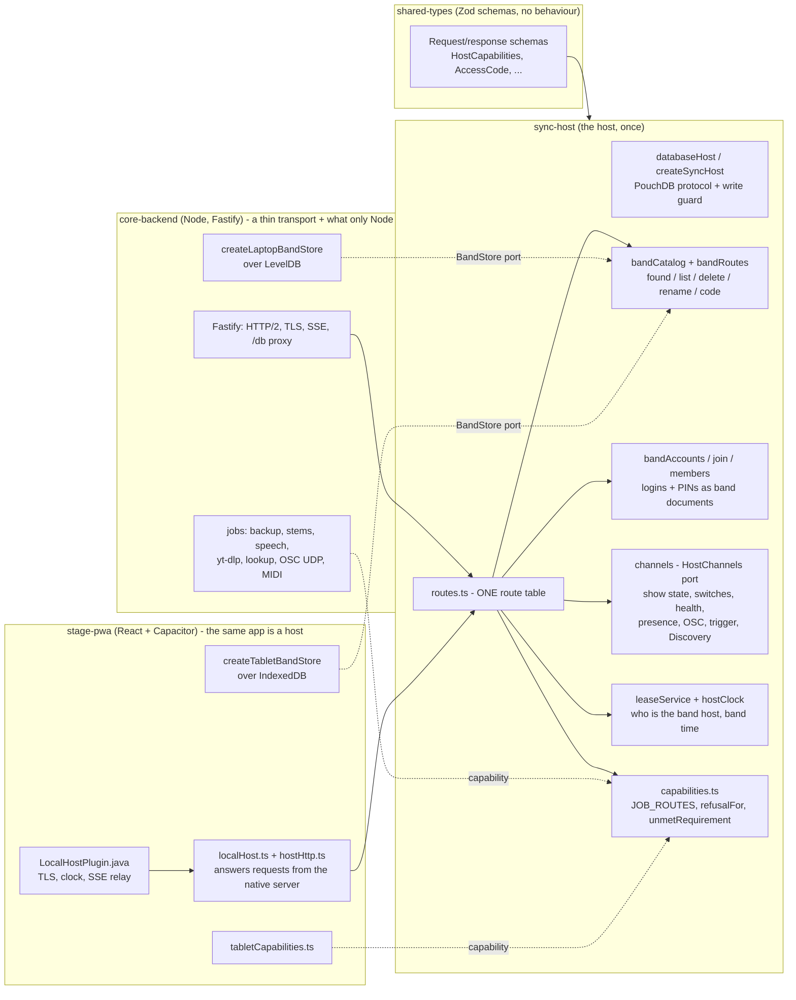
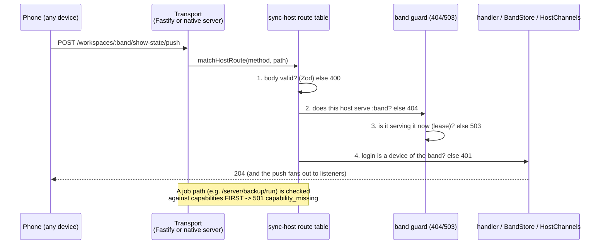
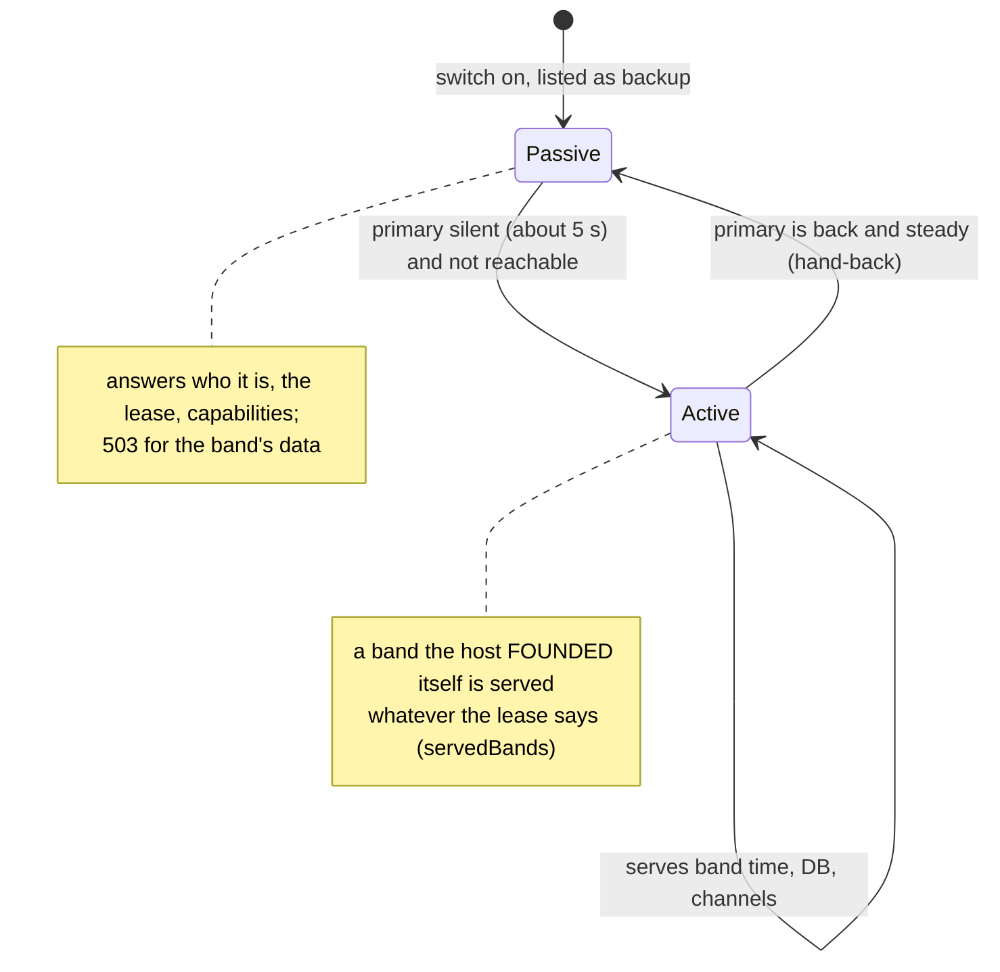
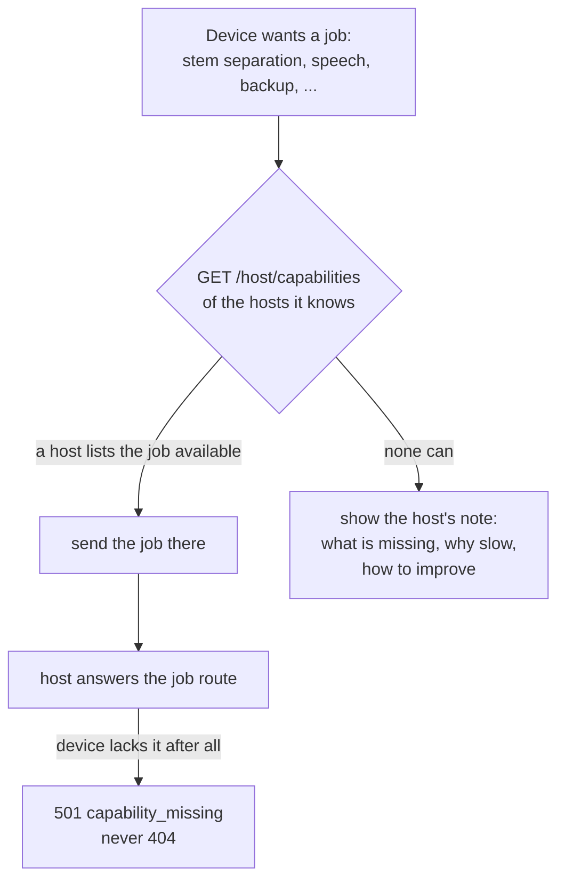

# 34 - Host architecture at a glance (#962)

*Written 2026-11-19 after #960 and #962. A map for newcomers; the reasons and the measurements stay in docs/25. Diagrams are Mermaid (GitHub renders them). Where a box says "not built", it is a gap, not a plan.*

**The one idea:** there is no "server" in the old sense. A **host** is a role any device can take. The code of a host lives once, in `sync-host`; a platform adds only a transport (how bytes arrive) and storage (where documents live). What a device can do on top is decided by the device alone and said by `GET /host/capabilities`.

## 1. Who owns what

Rule of thumb for a new function: **if it is a rule about a band, it belongs in `sync-host` over a small port. If it needs an operating-system tool (a binary, a UDP port, a drive), it is a *job* - it goes behind a capability, and the host that cannot do it answers 501.**

## 2. A request, on either host

The order is deliberate: a stranger learns nothing from a 400, nothing about which bands exist from a 403, and a device that cannot do a job is told *what is missing* instead of getting a misleading 404.

## 3. Roles over time: one band host at a time

- **Epoch** rises on every takeover; devices follow the highest epoch (`useHostFollower`).
- **Band time** is the primary's clock; the backup keeps a measured offset to it (`hostClock`), so a takeover does not make the beat jump.
- **Open:** a locked tablet screen can stop the host (docs/25 §6g); the native beat was rejected, keep the tablet awake and in front.

## 4. Where a job goes (capabilities)

| Job (in `JOB_ROUTES`) | Laptop | Tablet |
|---|---|---|
| backup, measure-inputs, calibration, lookup, plugin runtime, add-on install, hardware, OSC in | yes (Node) | not built yet (feasible) |
| speech (Piper) | if `piper` is installed | not built yet; clips are cached forever, a slow first run costs once |
| YouTube download | if `yt-dlp` is installed | **runs on the tablet itself** through the Android helper; not yet *for other devices* |
| stem separation | if `demucs` is installed | not built; measure first (docs/25: Phone ~2/3 of the laptop's single thread, Fire ~1/7) |

## 5. Data: one database, same code everywhere

- Every band is a PouchDB database `stageboard-<id>`; devices replicate with the host over the CouchDB protocol that `sync-host` implements. No CouchDB anywhere (#960).
- Logins and PINs are documents *of the band* (`account:*`, `anchor:*`), written only by `_admin` or a device the band lists as a host. A host can therefore be replaced without losing accounts.
- Revision history is bounded (`revs_limit: 50`, auto-compaction) on host and device after the first soak run showed an unbounded history slowing the host down (docs/25).
- The first band on a host is free; further bands need an admin login of a band on that host (or the laptop's own loopback). A deleted band is copied first and never founded again.

## 6. What is not built, and where the gaps are

| Gap | Why it matters | Where it is written |
|---|---|---|
| Tablet clock, `/time` and lease follow only the *active* band | a second founded band syncs but has no band time of its own | docs/25 (#962 step 1) |
| Streams the native relay does not carry (plugin health, OSC, Discovery, device trigger) | a tablet answers 501 for them | docs/25 (#962 step 2) |
| `LocalHostPlugin.java` knows the lease flag and `servedBands`, nothing finer | changes there need a real device | docs/25 |
| The app does not yet choose a host for a job by itself | step 4/6 of #962 is the rule, not the routing UI | docs/25 |
| Locked screen stops a tablet host | a band that runs on a tablet needs it awake | docs/25 §6g |
| `core-backend/src/index.ts` (about 1400 lines) still wires many routes by hand | candidates to move into the table as jobs | cleanup list |

## 7. Reading order

1. docs/25 (decisions and measurements, newest first at the top of the #962 paragraphs).
2. `packages/sync-host/src/host/routes.ts` - the whole public surface of a host in one file.
3. `packages/sync-host/src/host/capabilities.ts` - which requests need a capable device.
4. `packages/stage-pwa/src/host/localHost.ts` - how a tablet wires the same pieces.
5. `tools/host-test/no-laptop.mjs` - the executable description of what a host must do.
