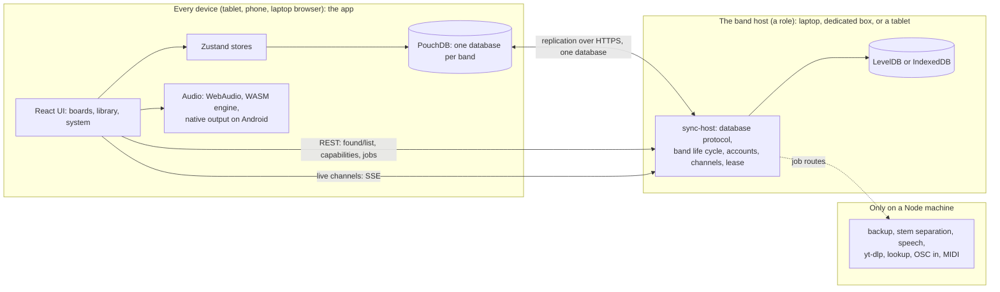
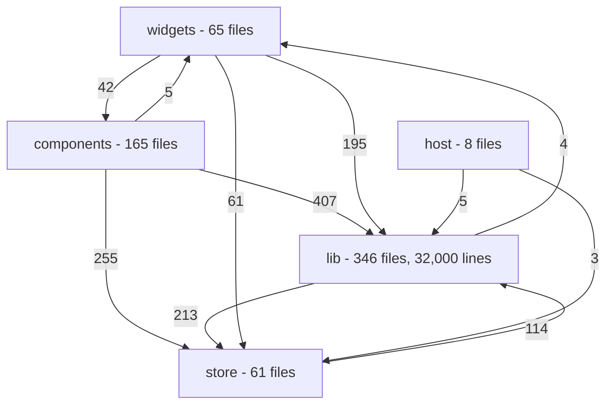
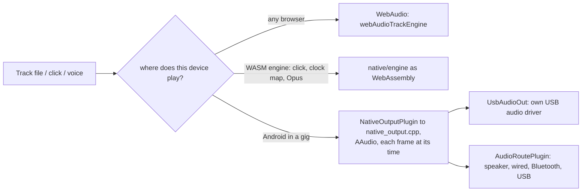

# 35 - The software at a glance

*Written 2026-11-20 from the code as it is on branch `feat/host-everywhere-962` (numbers counted that day, tests and generated files excluded). docs/34 is the zoom into the host; this page is the whole map. Where a statement is an observation of the code it says so; where it is a judgement it says that too.*

## 1. Four packages, two native parts

| Part | What it is | Size (non-test) | Runs on |
|---|---|---|---|
| `shared-types` | Zod schemas and pure helpers: the vocabulary every other part shares (documents, requests, capabilities). No behaviour. | - | everywhere |
| `sync-host` | **The host**: database protocol, band life cycle, accounts, live channels, lease/clock, capabilities (docs/34). | 40 files (non-test) | laptop (Node), tablet (inside the app) |
| `core-backend` | Node: **the Node shell** (listener, TLS, SSE, mDNS, files) plus the Node-only job code (backup, stems, speech, yt-dlp, OSC, MIDI, plugins). It has no second host implementation since #964. | about 7,600 lines non-test (was 7,834); `index.ts` 1,328 lines | laptop, dedicated Linux box |
| `stage-pwa` | The app (React + Vite + Capacitor): UI, local database, audio, and the tablet as a host. | about 71,000 lines: `lib` 32,000 / `components` 27,000 / `widgets` 6,000 / `store` 4,700 / `host` 1,200 | browser, Android |
| `native/engine` | C++ audio engine (click, clock map, Opus clip reader/writer), built to **WebAssembly** (`stageboard_engine.wasm`, `stageboard_opus.wasm`) and for Android. | 6 source files | inside the app |
| Android shell | Capacitor plus 10 Java plugins and a C++ output (`native_output.cpp`, AAudio). | 14 Java files | Android |

## 2. What runs where

- **Local-first:** every device holds the whole band in PouchDB and works offline; the host is where devices meet, not where data lives (docs/00).
- **One host at a time** per band (primary, optionally one backup that takes over after about 5 s; docs/25 §6e, docs/34 §3).
- **Capabilities:** a device that cannot do a job says what it lacks; the app sends the job to a host that can (`GET /host/capabilities`, docs/34 §4).

## 3. The app's layers - measured

Counted by `import` statements between the app's directories (non-test files):

What this says (observations, then judgement):

- The intended direction is `components → lib → store`. It mostly holds: components import `lib` 407 times and `store` 255 times.
- **`lib` and `store` import each other** (213 one way, 114 the other). That is a cycle between the two largest layers. ES modules tolerate it as long as nothing uses the other side while a module loads; the few places that would (for example `useShowStateStore` loading `readyCheckLog`) are cut with a dynamic `import()` - I found three in `lib` and two in `store`, not a systematic rule. Neither layer can be tested or moved alone. *Judgement: the main structural debt of the app.*
- **`widgets` use `components` 42 times, `components` use `widgets` 5 times:** a small loop around the dashboard.
- **`lib` is one flat folder of 535 files** (346 without tests). It holds audio, clocks, songs, hardware, networking and UI helpers side by side. A name-based sort puts 106 of its files in no obvious group. *Judgement: it should be split into folders by topic (below) before it grows further; the import counts show the topics are separable.*
- `host` is small and depends only downward on `lib` and `store` (8 imports). The host code in the app is a good example of the intended shape.

### Topics inside `lib` (from file names; roughly)

| Topic | Examples |
|---|---|
| Audio output and engine | `audioClient`, `webAudioTrackEngine`, `nativeOutput`, `engine/*` (WASM click, Opus), `stemEngine`, `announcements`, `useOutputPlan` |
| Clock and sync | `clockSync`, `timeBase`, `hostEpoch`, `hostFollow`, `hostContact`, presence and ready-check hooks |
| Songs, setlists, timeline | `chordpro`, `chordSymbol`, `cueFiring`, `cueChase`, timeline helpers |
| Band, accounts, join | `workspaceDb`, `bandSettingsDb`, `deviceId`, QR and join helpers |
| Hardware, plugins, triggers | `capabilities`, `pluginCatalog`, `loadClientPlugin`, `showControlClient`, `discoveryClient`, MIDI and OSC |
| Host connection | `hostUrl`, `jobHost` / `jobChoice` (which host does a job), `fetchHostCapabilities`, `trackedSync` |
| Rig-Check and calibration | `rigCheck*`, `alignment*`, `audioCalibration` |

## 4. The data: one database per band

Each band is one PouchDB database `stageboard-<id>`; every document has a kind prefix (`songs:`, `setlists:`, ...). The app opens it through `createWorkspaceCollection<T>(kind)`, so a screen never talks to PouchDB directly. Kinds in use (26):

| Group | Kinds |
|---|---|
| Repertoire | `songs`, `song-variants`, `setlists`, `saved-loop`, `practice-log` |
| People and devices | `profiles`, `devices`, `band-settings`, `show-protection` |
| Layout | `dashboards`, `widgets`, `gadgets`, `stage-equipment`, `stage-front`, `stage-setups` |
| Hardware and triggers | `plugins`, `addon-sources`, `logical-devices`, `device-transport-config`, `midi-controller-rules`, `osc-input-rules`, `switch`, `latency-profile` |
| **Status, not saved work** | `show-state`, `showlog`, `async-jobs`, `alignment-session` - they replicate like everything else, but the sync indicator ignores them (`isStatusDocId`) |

Plus the band's own bookkeeping, written by the host: `workspace:access` (name, code, founding host), `account:*` and `anchor:*` (logins and PIN verifiers), `_design/roster` (who may write what).

## 5. Audio: three ways out

Decisions and measurements live in docs/29 (sync), docs/30 (output, incl. native engine concept §8), docs/21 (timing and calibration), docs/26 (real-time budget).

## 6. Android: the Java plugins

| Plugin | Job |
|---|---|
| `LocalHostPlugin` | the tablet as a host: HTTPS server, clock answer, live-channel relay (`servedBands`) |
| `NativeOutputPlugin`, `UsbAudioOut`, `AudioRoutePlugin` | native audio output, own USB driver, which output is in use |
| `PlaybackService` + plugin | keeps the app in front while it plays |
| `WifiLockPlugin`, `DeviceVitalsPlugin` | WiFi without power saving during a gig; device diagnostics |
| `ServerTrustPlugin`, `ServerDiscoveryPlugin` | certificate pinning by fingerprint; finding hosts by DNS-SD |
| `NativeHelperPlugin` | add-on helpers (separate app packages, e.g. YouTube) |
| `PrintPlugin` | printing and PDF |

(`ServerTrust`/`ServerDiscovery` keep the word "Server" in their class names; the rename of #962 touched the app and docs, not these native class names or their JavaScript bridge names.)

## 7. Extending the app: three mechanisms

1. **Widgets** (65 files in `widgets/`, 33 of them widget components, `widgets/registry`): what a dashboard shows. Each declares what it `requires` from the capabilities.
2. **Plugins and add-ons:** add-ons replicate as documents; a built-in add-on is a directory (`manifest.json`, `work.js`, for UI also `view.js`, docs/36): the **view script** runs on every device that shows the add-on, in a Worker of its own; the **work script** runs on any device that has what it needs (`runsOn`, its helpers) - in a Node `--permission` process on a laptop, in a Worker of the app on a tablet (there is no server); a heavy program is a **helper** the device runs for the add-on (never the add-on itself). The add-on holds no network, file or program: it asks StageBoard (`capability.*`), which checks the band's permissions. See docs/36 (the contract) and docs/32 (manifest, versions, distribution).
3. **Jobs behind capabilities:** anything that needs an operating-system tool (docs/34 §1).

## 8. Where the weak spots are (judgement, with the evidence)

| Spot | Evidence | Why it matters |
|---|---|---|
| `lib` ↔ `store` cycle | 213 vs 114 imports between them | neither layer can be moved or tested alone |
| `lib` is flat | 346 non-test files, 32,000 lines, 106 files in no topic | hard to find things, easy to couple by accident |
| `core-backend/src/index.ts` | 1,328 lines, 23 explicit routes | the job routes and the job execution (`asyncJobWatcher.ts`, 458 lines) are Node code that is declared by runners but not yet behind them (#964 step 3b) |
| `localHost.ts` | about 640 lines in one function-heavy module | the tablet host's wiring is hard to test as a whole; `serving.ts` and `bandScan.ts` were pulled out for that reason |
| Android native class names | `ServerTrust*`, `ServerDiscovery*` | the vocabulary of #962 stops at the JavaScript bridge |
| Long-running host | soak runs (docs/25) | a document written thousands of times slows its own writes; a bounded revision history crashes PouchDB (tried, reverted) |

## 9. Reading order for a newcomer

1. CLAUDE.md (principles and the doc index), then docs/00 (vision) and this page.
2. docs/34 for anything that touches the host.
3. `packages/stage-pwa/src/App.tsx` - the app's wiring in one file (about 50 hook calls and the three modes `boards`, `library`, `system`).
4. `packages/stage-pwa/src/lib/workspaceCollection.ts` and `workspaceDb.ts` - how data is read and written.
5. docs/30 and docs/29 for sound and time; docs/31 for the stage map; docs/32 for add-ons.
